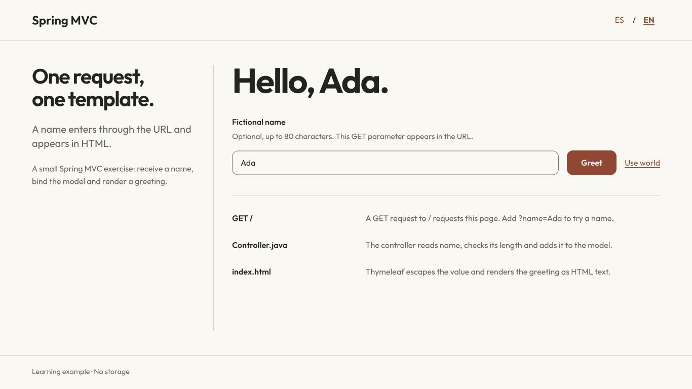
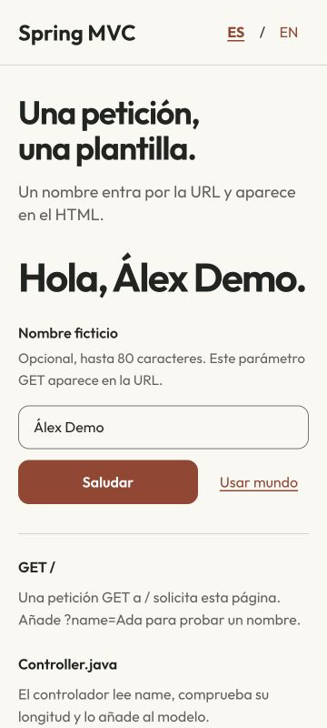
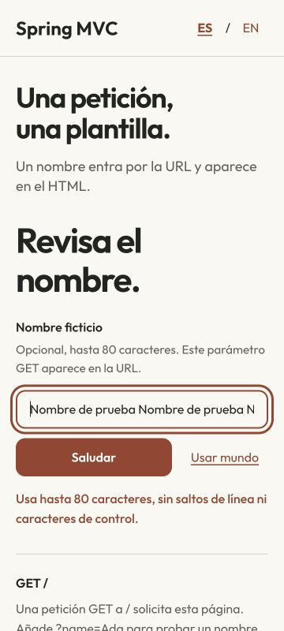

# Four small Spring exercises

[Español](README.es.md) · [Source and checks](docs/verification.json) · [Design decisions](DESIGN.md)

Historical Java coursework, reviewed as four independent lessons. The REST task example, JSON greeting, JPA model and MVC page each have their own Maven wrapper and application context. They are learning examples; they do not demonstrate production security or a current Spring upgrade.



## Pick a lesson

| Module | What it actually does | Local tests |
| --- | --- | --- |
| [01_PrimerApiRes](01_PrimerApiRes) | H2-backed task CRUD at `/task/`; generated identity, validation and missing-resource errors | 14 |
| [EO1](EO1) | JSON greeting at `/saludo?name=Ada`; Spanish content and process-local atomic counter | 5 |
| [05_PrimerProyectoSpringData](05_PrimerProyectoSpringData) | One `Alumno` JPA entity; persist, reload, edit and remove in tests. No API or repository implementation | 4 |
| [demo](demo) | Thymeleaf greeting at `/`; fictional name, ES/EN, escaped output and inline errors | 10 |

The 33 tests include the four original context tests. They passed locally on macOS with Corretto 17.0.14. No hosted CI was added. The original Spring Boot 2.5.4/2.5.5 dependencies remain pinned; the POMs target Java 16 or 17, but Java 16 runtime was not tested.

## Run one module

Use JDK 17 and the wrapper inside the chosen module:

```sh
cd 01_PrimerApiRes
sh ./mvnw verify
java -jar target/01_PrimerApiRes-0.0.1-SNAPSHOT.jar --server.port=8080
```

Use the same steps for `EO1` (`target/EO1-0.0.1-SNAPSHOT.jar`) or `demo` (`target/demo-0.0.1-SNAPSHOT.jar`). The default port is ephemeral; read the actual port from the Tomcat startup line. The example override above binds only to `127.0.0.1`; choose a free port. Each module is standalone; there is no parent reactor.

For the model-only lesson:

```sh
cd 05_PrimerProyectoSpringData
sh ./mvnw verify
java -jar target/05_PrimerProyectoSpringData-0.0.1-SNAPSHOT.jar --spring.main.web-application-type=none
```

The JPA modules use memory-only H2 and drop their schema at shutdown. The task seed contains two fictional teaching tasks. Restarting loses changes; no previous file database is opened. Run only with fictional data.

## Task HTTP contract

```sh
curl -i http://127.0.0.1:8080/task/
curl -i -H 'Content-Type: application/json' \
  -d '{"title":"Review the exercise","text":"Fictional task"}' \
  http://127.0.0.1:8080/task/
```

Use the returned ID for `GET /task/{id}`, `PUT /task/{id}` and `DELETE /task/{id}`. Successful creation returns 201, deletion 204. Missing IDs return 404 with `{"code":"not_found"}`. Invalid JSON, a supplied nonzero ID on creation, a blank title or fields over 255 characters return 400 with `{"code":"invalid_request"}`; rejected writes leave existing rows unchanged. Text is optional. PUT takes identity from the path, preserving the original contract when the body contains a different ID. Unsupported methods retain 405 and the Allow header.

There is no authentication, pagination or concurrency guarantee. This is a small CRUD lesson, not an exposed service or production deployment.

## MVC page

Open `http://127.0.0.1:8080/?lang=es` when running `demo` on that port; use `lang=en` for English. The optional fictional name is sent in a GET URL, which can appear in browser/server history. Blank means world; over 80 characters or control characters return 400 with the draft and an associated inline error. Thymeleaf escapes markup. Reset and language links work without JavaScript; language changes preserve the submitted name. Fonts and CSS are local, with visible focus and a stacked mobile layout.




Verification covers all four Maven packages, 26 real HTTP requests against JARs, model-only startup, exact packaged resources and browser paths at 1366×768, 360×800 and 800×360. It does not claim a screen-reader audit, physical devices, store publishing, production readiness or an upgrade/security audit.

## Provenance

Original coursework and credits remain below, with history and unrelated files preserved. Existing code is not relicensed by this review. Outfit is redistributed under its included [OFL notice](demo/src/main/resources/static/fonts/OFL.txt); see [third-party details](THIRD_PARTY.md). Screenshots show the executed local app, not generated concepts.

<details>
<summary>Original documentation and credits · Documentación y créditos originales</summary>

# dam-psp-workspace
Workspace dedicado a recabar apuntes para los modulos de Acceso a datos y programación de servicios y procesos. 

</details>

[More mobile engineering work](https://github.com/navalcode)
